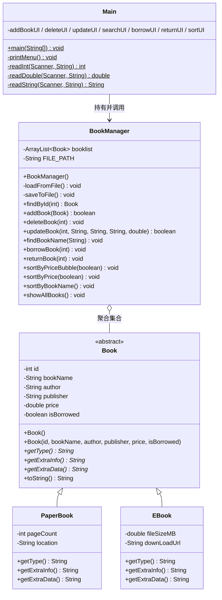

# Simple Library System 开发文档

| 项目 | 内容 |
|---|---|
| 项目名称 | Simple Library System（控制台图书管理系统） |
| 代码规模 | 5 个类、812 行（Book 84 / PaperBook 47 / EBook 45 / BookManager 354 / Main 282） |
| 最低 JDK | **11**（`FileReader(File, Charset)`、`FileWriter(File, Charset)` 自 JDK 11 起提供） |
| 构建方式 | 纯 `javac` 编译，无构建工具、无第三方依赖 |
| 数据存储 | 项目根目录 `books.txt`，UTF-8，`|` 分隔的纯文本 |
| 文档版本 | v1.0（依据 2026-11-18 的源码实测编写） |

---

## 1. 项目概述

本项目是一个面向初学者的 Java SE 综合练习：以"图书管理"为业务载体，覆盖**面向对象设计、集合使用、文件持久化、异常处理、排序算法与函数式接口**六类核心能力。程序为纯控制台交互，启动即加载本地数据，退出不额外保存（所有写操作均即时落盘）。

**设计目标**

1. 用抽象类 + 多态表达"多种图书类型共用一套管理逻辑"；
2. 用最朴素的文本文件实现数据持久化，不引入数据库或序列化框架；
3. 代码自带完整中文注释，便于逐行阅读与二次练习。

**非目标（当前不涉及）**

并发控制、图形界面、网络访问、用户权限、事务与幂等、单元测试工程化。

---

## 2. 技术栈与环境

| 类别 | 选型 | 说明 |
|---|---|---|
| 语言 | Java SE | 未使用任何 Java EE / 框架能力 |
| 集合 | `java.util.ArrayList` | 内存中维护图书列表，顺序即文件顺序 |
| IO | `BufferedReader` / `BufferedWriter` + `FileReader` / `FileWriter` | 按行读写，显式指定 `StandardCharsets.UTF_8` |
| 排序 | 冒泡（手写）+ `Comparator` / `Comparator.comparingDouble` | 两种实现并存，用于对比教学 |
| 输入 | `java.util.Scanner` | 行读取 + `trim` + 异常重试 |
| IDE | IntelliJ IDEA（可选） | 项目自带 `.iml`，模块名为 `Simple Library System` |

**编码约定**

- 源码、`books.txt` 统一 UTF-8；
- 编译时必须带 `-encoding UTF-8`，否则中文注释与字符串可能告警或乱码；
- Windows 控制台输出中文建议加 `-Dstdout.encoding=UTF-8`（JDK 19+ 默认 UTF-8 可省略）。

---

## 3. 工程结构

```text
Simple Library System/
├── src/
│   ├── Book.java          抽象基类，定义公共属性与三个抽象方法
│   ├── PaperBook.java     纸质书子类
│   ├── EBook.java         电子书子类
│   ├── BookManager.java   业务与持久化核心
│   └── Main.java          程序入口与控制台交互
├── books.txt              数据文件（运行时生成/覆盖）
├── README.md              使用说明
├── 开发文档.md             本文件
└── Simple Library System.iml
```

所有类位于默认包（无 `package` 声明），属于教学项目的简化处理；正式工程应划分 `model` / `service` / `ui` 三层包。

---

## 4. 架构设计

### 4.1 类图



### 4.2 分层与职责

| 类 | 层次 | 核心职责 | 关键设计点 |
|---|---|---|---|
| `Book` | 模型层（抽象） | 定义图书公共字段、公共构造器、`toString()` 骨架 | 三个抽象方法把"类型差异"下推到子类 |
| `PaperBook` | 模型层 | 纸质书特有字段（页数、馆藏位置） | 实现 `getType()` 返回 `PAPER` |
| `EBook` | 模型层 | 电子书特有字段（大小、下载地址） | 实现 `getType()` 返回 `EBOOK` |
| `BookManager` | 业务 + 持久化层 | 内存集合 CRUD、借还、排序、文件加载/保存 | 内部 `ArrayList<Book>`；所有写操作末尾调用 `saveToFile()` |
| `Main` | 表现层 | 菜单循环、控制台输入读取与校验、调用业务方法 | 输入校验用 `while(true)` + 异常重试 |

**调用链**：`Main`（UI）→ `BookManager`（业务）→ `Book` 子类（多态）→ `books.txt`（持久化）。

### 4.3 多态设计意图

`BookManager` 全程只与 `Book` 类型交互，从不判断"这是纸质书还是电子书"。类型差异由三个抽象方法承载：

- `getType()`：给持久化用的**类型标记**（`PAPER` / `EBOOK`）；
- `getExtraInfo()`：给控制台展示用的**人类可读补充信息**（"页数:120 / 馆藏位置:A区12"）；
- `getExtraData()`：给持久化用的**附加字段序列化**（`120|A区12`）。

好处：新增图书类型（如 `AudioBook`）只需新增子类 + 在 `loadFromFile()` 增加一个分支，管理逻辑不需要改。

代价：**类型标记散落在两处**（子类 `getType()` 与 `loadFromFile()` 的字面量比较），这是本项目最易踩坑的地方，见第 8 章"已修复缺陷"。

---

## 5. 数据模型

### 5.1 内存模型

`BookManager.booklist` 是一个 `ArrayList<Book>`，元素实际运行时类型为 `PaperBook` 或 `EBook`。列表顺序 == 文件行顺序 == 展示顺序，排序后同步落盘。

### 5.2 公共字段

| 字段 | 类型 | 约束 |
|---|---|---|
| `id` | `int` | 业务主键，`addBook` 按此判重；未做正数校验 |
| `bookName` | `String` | 非空（UI 层 `readString` 拦截空串） |
| `author` | `String` | 非空 |
| `publisher` | `String` | 非空 |
| `price` | `double` | `readDouble` 要求 > 0 |
| `isBorrowed` | `boolean` | 默认 `false`，借阅置 `true` |

### 5.3 子类特有字段

| 子类 | 字段 | 类型 | 说明 |
|---|---|---|---|
| `PaperBook` | `pageCount` | `int` | 页数，未做范围校验 |
| `PaperBook` | `location` | `String` | 馆藏位置，如 `A区12` |
| `EBook` | `fileSizeMB` | `double` | 文件大小（MB） |
| `EBook` | `downLoadUrl` | `String` | 下载地址 |

---

## 6. 持久化协议

### 6.1 文件格式

一行一本书，字段以 `|` 分隔，固定 **9 段**，UTF-8 编码，换行 `\r\n` 或 `\n` 均可（读入时按行切分）。

```text
PAPER|1|java|xym|程序员cbs|12.0|false|120|A区12
EBOOK|2|设计模式|GoF|机械出版社|45.5|true|3.2|https://example.com/book.pdf
```

| 段序 | 含义 | PAPER | EBOOK | 解析代码 |
|:---:|---|---|---|---|
| 1 | 类型标记 | `PAPER` | `EBOOK` | `"PAPER".equals(type)` 分支 |
| 2 | 图书编号 | `int` | `int` | `Integer.parseInt(parts[1])` |
| 3 | 书名 | String | String | `parts[2]` |
| 4 | 作者 | String | String | `parts[3]` |
| 5 | 出版社 | String | String | `parts[4]` |
| 6 | 价格 | double | double | `Double.parseDouble(parts[5])` |
| 7 | 借阅状态 | boolean | boolean | `Boolean.parseBoolean(parts[6])` |
| 8 | 附加 1 | 页数 int | 文件大小 double | `parts[7]` |
| 9 | 附加 2 | 馆藏位置 | 下载地址 | `parts[8]` |

### 6.2 为什么"附加信息"能占两段

`saveToFile()` 只拼接 8 个 `|` 之前的部分，最后一段直接写入 `book.getExtraData()`：

```java
writer.write(book.getType() + "|" + book.getId() + "|" + book.getBookName() + "|" + book.getAuthor()
        + "|" + book.getPublisher() + "|" + book.getPrice() + "|" + book.isBorrowed() + "|"
        + book.getExtraData());
```

而 `getExtraData()` 在一段字符串里**自己带一个 `|`**：

```java
// PaperBook
return pageCount + "|" + location;
// EBook
return fileSizeMB + "|" + downLoadUrl;
```

两段拼起来正好 9 个字段。这是本项目的隐式契约：

> **新增子类时，`getExtraData()` 必须返回"恰好两段"（一个 `|`）**，否则 `parts.length != 9`，整行会被当作格式异常跳过。

### 6.3 加载容错策略

`loadFromFile()` 对异常逐行降级，**任何一行出错都不会中断整体加载**：

| 情况 | 处理 |
|---|---|
| 文件不存在 | 打印"未发现数据文件，从空白书库开始"，列表为空 |
| 空行 | `continue` 跳过 |
| 段数 ≠ 9 | 打印"跳过格式异常的行"，跳过该行 |
| 类型不识别 | 打印"未知图书类型，跳过"，跳过该行 |
| 数字解析失败 | 捕获 `NumberFormatException`，打印"跳过数据损坏的行"，跳过该行 |
| IO 异常 | 打印"读取文件失败"，保留已加载部分 |

加载完成后统一打印"已从文件加载 N 本图书"。

### 6.4 写入策略

`saveToFile()` 用 `FileWriter(FILE_PATH, UTF_8)` **覆盖写**（非追加），每次写操作后全量重写文件。特征与风险：

- 简单可靠，无需维护增量；
- **非原子**：写入过程中若异常/断电，可能留下截断的半截文件，导致下次加载只剩部分数据；
- **空列表会清空文件**：加载结果为 0 本时，任一写操作都会把 `books.txt` 覆盖成空（这是最常见的"数据丢失"现场）。

---

## 7. 核心流程

### 7.1 启动与加载

```text
Main.main()
  └─ new Scanner(System.in)
  └─ new BookManager()          → 构造器内调用 loadFromFile()
        └─ File("books.txt").exists()?  否 → 提示并返回
        └─ BufferedReader(FileReader(file, UTF_8))
              └─ 逐行 readLine() → trim 判空 → split("\\|", -1)
                    └─ 长度校验(9) → 类型分支 → new PaperBook / new EBook
                          └─ booklist.add(book)
        └─ 打印"已从文件加载 N 本图书"
  └─ while(true) { printMenu() → readInt() → switch }
```

关键点：**加载只发生一次**，在 `BookManager` 构造时。运行期间的修改都直接作用于内存列表并即时落盘，不重新读文件。

### 7.2 添加图书

```text
Main.addBookUI()
  ├─ readInt(编号) / readString(书名/作者/出版社) / readDouble(价格)
  ├─ readInt(类型 1 纸质 2 电子)
  ├─ 分支读取特有待段 → new PaperBook(...) / new EBook(...)
  └─ BookManager.addBook(book)
        ├─ findById(book.getId()) != null → 打印"编号已存在"，return false
        ├─ booklist.add(book)
        ├─ 打印"添加成功：《书名》"
        └─ saveToFile()   ← 即时落盘
```

### 7.3 借阅 / 归还

| 操作 | 前置校验 | 状态变更 | 落盘 |
|---|---|---|---|
| `borrowBook(id)` | 书存在、`!isBorrowed` | `setBorrowed(true)` | 是 |
| `returnBook(id)` | 书存在、`isBorrowed` | `setBorrowed(false)` | 是 |

### 7.4 删除 / 修改

| 操作 | 逻辑 | 落盘 |
|---|---|---|
| `deleteBook(id)` | `findById` → 不存在则提示；存在则 `booklist.remove(b)` | 是 |
| `updateBook(id, ...)` | `findById` → null 返回 false；否则重设书名/作者/出版社/价格 | 是 |

> `updateBook` 只能改 4 个字段，无法修改图书类型、页数、馆藏位置、下载地址、借阅状态。

### 7.5 排序

两条并存实现：

1. **手写冒泡** `sortByPriceBubble(boolean asc)` — 教学用，**当前实现有索引错误（见 8.2），且 `Main` 未调用**；
2. **`Comparator`** `sortByPrice(boolean asc)` — 实际生效：

```java
Comparator<Book> c = Comparator.comparingDouble(Book::getPrice);
if (!asc) c = c.reversed();
booklist.sort(c);
saveToFile();     // 排序结果立即落盘
```

3. `sortByBookName()` — `Comparator.comparing(Book::getBookName)`，按书名自然顺序（区分大小写、按 Unicode 码点）。

排序后 `Main.sortUI` 会再调用 `showAllBooks()` 展示结果。

### 7.6 展示

`showAllBooks()`：

```text
booklist.isEmpty()? → 打印"暂无图书，请先添加！" 并 return
否则 → 打印"=====图书列表（共 N 本）====="
      → 逐本 System.out.println(book)   // 走 Book.toString()
      → 打印分隔线 "------------------------"
```

`toString()` 输出结构：编号 / 书名 / 作者 / 出版社 / 价格 / 类型 / 状态 / `getExtraInfo()`。
注意"类型"直接输出 `getType()`，因此界面显示为英文 `PAPER` / `EBOOK`。

---

## 8. 关键技术点说明

| 技术点 | 位置 | 说明 |
|---|---|---|
| `split("\\|", -1)` | `loadFromFile` | **`-1` 必须保留**。不加 limit 时，末尾连续空字段会被丢弃（如 `a\|b\|\|` 只剩 2 段），导致列数校验失效。 |
| `try-with-resources` | `loadFromFile` / `saveToFile` | 自动关闭流，避免异常时句柄泄漏。 |
| `new FileReader(file, StandardCharsets.UTF_8)` | `loadFromFile` | JDK 11+ 构造器；JDK 8 需用 `new InputStreamReader(new FileInputStream(file), UTF_8)`。 |
| 抽象类 + 三个抽象方法 | `Book` | 把"类型标记 / 显示文本 / 序列化文本"三种差异统一抽象，管理逻辑无需感知类型。 |
| `while(true)` + `catch(NumberFormatException)` | `Main.readInt/readDouble` | 控制台输入的标准防御式写法：非法输入提示后重新读取，不抛出到 `main`。 |
| `Comparator.comparingDouble(...).reversed()` | `BookManager.sortByPrice` | 函数式接口 + 方法引用；`double` 专用比较器避免装箱误差。 |
| 无参 + 全参构造器并存 | 各模型类 | 无参构造器为将来反射/框架反序列化预留，当前未使用。 |
| `private static` 工具方法 | `Main` | 不依赖实例状态，`main` 中直接调用。 |

---

## 9. 编译、运行与调试

### 9.1 命令行

```bat
:: 在项目根目录（含 books.txt 的目录）执行
javac -encoding UTF-8 -d out src\*.java
java -cp out Main
```

PowerShell：

```powershell
javac -encoding UTF-8 -d out (Get-ChildItem src\*.java).FullName
java -cp out Main
```

### 9.2 调试要点

- **工作目录**：`FILE_PATH = "books.txt"` 是相对路径，解析基准是 JVM 的 `user.dir`。IDEA 默认 `$ProjectFileDir$` 正确；若改成 `<module>/src` 会读不到文件。
- **编码**：`javac` 不带 `-encoding UTF-8` 时，源码中的中文以 GBK 解读，可能编译告警或字符串乱码。
- **控制台中文**：Windows 下 Java 默认用系统代码页输出，PowerShell 按 UTF-8 解码会乱码，加 `-Dstdout.encoding=UTF-8` 即可。
- **数据复原**：手动测试前先复制一份 `books.txt`，避免写操作覆盖。

---

## 10. 已知问题与风险清单

> 严重度：🔴 高（会损坏数据/阻断使用）｜🟠 中（功能缺陷或体验问题）｜🟡 低（代码质量/可维护性）

| # | 严重度 | 位置 | 问题 | 建议 |
|:---:|:---:|---|---|---|
| 1 | 🔴 | `BookManager.sortByPriceBubble` | 冒泡排序索引写错：`Book left = booklist.get(i);` 应为 `get(j)`。由于 `left` 取自外层索引 `i`，后续 `set(j, right)` / `set(j+1, left)` 会把第 `i` 个元素复制到 `j+1`，造成**元素重复与丢失**，排序结果错误且破坏列表。 | 改为 `booklist.get(j)`，或直接比较 `booklist.get(j)` 与 `get(j+1)`；确认修复前不要调用该方法。 |
| 2 | 🔴 | `BookManager.saveToFile` | 覆盖写非原子；且空列表会**清空整个文件**，与"加载 0 本"叠加会造成数据全丢。 | 先写 `books.txt.tmp` 再 `Files.move(..., REPLACE_EXISTING, ATOMIC_MOVE)`；空列表时拒绝覆盖或先备份。 |
| 3 | 🟠 | 持久化格式 | 字段无转义，书名/作者/位置中若含 `\|`，整行段数变多 → 被判格式异常跳过（数据静默丢失）。 | 保存时对 `\|` 与换行做转义（如 `\\|`），读取时反转义；或改用 CSV 库/JSON。 |
| 4 | 🟠 | `BookManager.FILE_PATH` | 硬编码相对路径，依赖工作目录；换运行方式即读不到数据。 | 从 `args` / 系统属性 / `System.getProperty("user.dir")` 显式构造路径，或落到用户目录。 |
| 5 | 🟠 | `Book` / `toString` | "类型"显示 `PAPER`/`EBOOK` 英文标记，界面不友好。 | 增加 `getTypeName()` 返回"纸质书/电子书"，`toString` 用它，`getType()` 专用于持久化。 |
| 6 | 🟠 | `Main.readDouble` | 复用同一方法读取"文件大小"，提示语固定为"价格必须大于0"，文案错误；且文件大小被强制 > 0。 | 抽出 `readPositiveDouble(sc, tip)`，把提示语参数化。 |
| 7 | 🟠 | 全项目 | 无任何单元测试，回归全靠手工。 | 引入 JUnit 5，对 `loadFromFile` / `addBook` / 排序 / 借还写用例；文件 IO 用临时目录。 |
| 8 | 🟡 | `BookManager.updateBook` | 仅能改书名/作者/出版社/价格，无法改类型与子类特有字段；也未处理编号冲突。 | 扩展为按类型分派更新，或提供按字段的 setter 入口。 |
| 9 | 🟡 | 输入校验 | `id` 允许负数/0；`pageCount` 允许负数；`price` 无上限；文件名/地址无长度限制。 | 在 `readInt` 增加区间参数；模型层加字段校验方法。 |
| 10 | 🟡 | 命名 | `pricce`（价格）、`publishere`（出版社）、`isBorrowwed`（借阅状态）、`findBookName`（应为 `findBooksByName`）等拼写问题。 | 统一重命名，IDE 一键 Refactor。 |
| 11 | 🟡 | `BookManager.findById` 内 `Double price` | 使用装箱类型 `Double` 接收 `parseDouble` 结果，随后自动拆箱；无实际收益且可能 NPE。 | 改为 `double price`。 |
| 12 | 🟡 | 包结构 | 所有类在默认包，无法体现分层。 | 拆为 `com.example.library.model` / `.service` / `.ui`。 |
| 13 | 🟡 | 设计 | 排序等"查看类"操作也会 `saveToFile()`，读写职责耦合。 | 落盘策略显式化：只在数据变更时保存，或提供 `flush()` 由调用方决定。 |
| 14 | 🟡 | 扩展性 | `isBorrowed` 仅一个布尔值，无借阅人、借阅时间、归还期限。 | 引入 `BorrowRecord`，或把状态升级为枚举 + 时间戳。 |

---

## 11. 已修复缺陷记录

### 2026-11-18 · 类型标记不一致导致"文件有内容却显示无图书"

| 项 | 内容 |
|---|---|
| 现象 | `books.txt` 内有数据，启动选择"2.显示所有图书"却输出"暂无图书，请先添加！" |
| 根因 | 写入端 `PaperBook.getType()` 返回 `"PaperBook"`、`EBook.getType()` 返回 `"EBook"`，而读取端 `loadFromFile()` 用 `"PAPER".equals(type)` / `"EBOOK".equals(type)` 比较。字符串大小写与拼写不一致，每行都落入 `else` 分支被判"未知图书类型"并 `continue`，最终 `booklist` 为空。 |
| 影响 | 加载恒为 0 本；此后任一写操作会用空列表覆盖 `books.txt`，造成原始数据丢失。 |
| 修复 | 1）`PaperBook.getType()` 返回 `PAPER`，`EBook.getType()` 返回 `EBOOK`，与读取端字面量统一；2）同步把 `books.txt` 中的类型列改为大写 `PAPER`。 |
| 验证 | 重新编译运行，启动输出 `已从文件加载1本图书。`，选择"2"可正常列出该书。 |
| 后续建议 | 见风险 #5：把"存储标记"与"显示名称"拆成两个方法，避免改显示文案时再次破坏持久化。 |

---

## 12. 改进路线

**P0（先保数据安全）**

1. 修复 `sortByPriceBubble` 索引错误；
2. `saveToFile` 改为"临时文件 + 原子替换"，并在列表为空时拒绝覆盖；
3. 增加 `books.txt` 自动备份（如 `books.txt.bak`，每次写入前滚动保留一份）。

**P1（健壮性与可维护性）**

4. 字段转义 / 换 CSV-JSON 格式，消除 `|` 冲突；
5. 路径可配置 + 加载失败给出明确原因与统计；
6. 抽出 `BookRepository`（持久化）与 `BookService`（业务），`Main` 只做交互；
7. 引入 JUnit 5 单元测试覆盖加载、CRUD、排序。

**P2（功能增强）**

8. `getTypeName()` 中文展示；`updateBook` 支持全字段；
9. 借阅记录（借阅人、时间、应还日期）；
10. 分页展示 / 按类型筛选 / 统计报表（总数、已借出数、总价值）；
11. 若需界面，可平移为 Swing 或 Spring Boot + REST。

---

## 13. 手工测试清单

| 编号 | 场景 | 操作 | 预期结果 |
|:---:|---|---|---|
| T1 | 正常加载 | 预置 1 行合法 `PAPER` 数据，启动 | 输出"已从文件加载1本图书。" |
| T2 | 类型错误 | 把类型改成 `Paper`，启动 | 输出"未知图书类型，跳过：..."，加载 0 本 |
| T3 | 段数错误 | 删掉最后一列，启动 | 输出"跳过格式异常的行：..." |
| T4 | 数字损坏 | 把价格改成 `abc`，启动 | 输出"跳过数据损坏的行：..." |
| T5 | 文件缺失 | 删除 `books.txt` 后启动 | 输出"未发现数据文件，从空白书库开始" |
| T6 | 添加判重 | 添加已存在的编号 1 | 输出"添加失败：编号1的图书已存在！" |
| T7 | 借阅幂等 | 对已借出的书再次借阅 | 输出"已被借出，无法重复借阅。" |
| T8 | 归还前置 | 对未借出的书归还 | 输出"当前是「可借阅」状态，无需归还" |
| T9 | 排序落盘 | 添加 3 本不同价格的书，选"1.按价格升序" | 列表按价格升序，退出后重开顺序保持 |
| T10 | 中文编码 | 添加含中文的书名并重启 | 中文正常显示，无乱码 |
| T11 | 空输入 | 功能编号处直接回车 | 输出"请输入整数数字"，重新提示 |
| T12 | 退出 | 输入 0 | 输出"感谢使用，再见！"，进程结束 |
